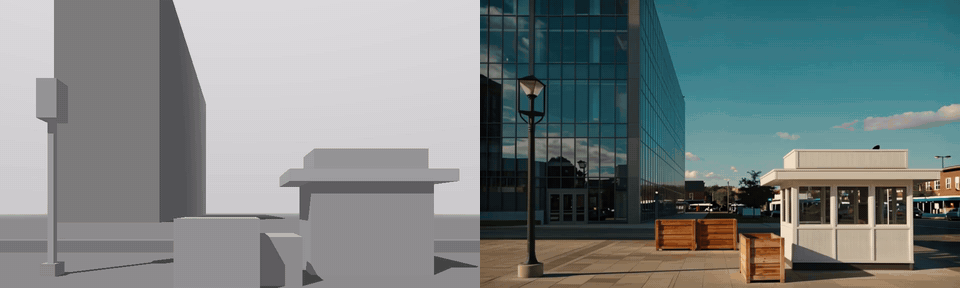
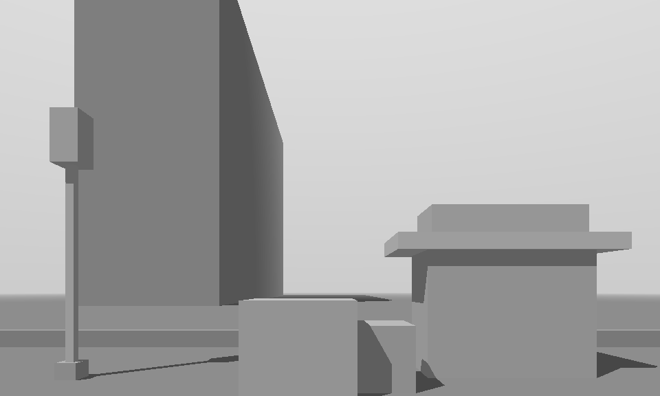
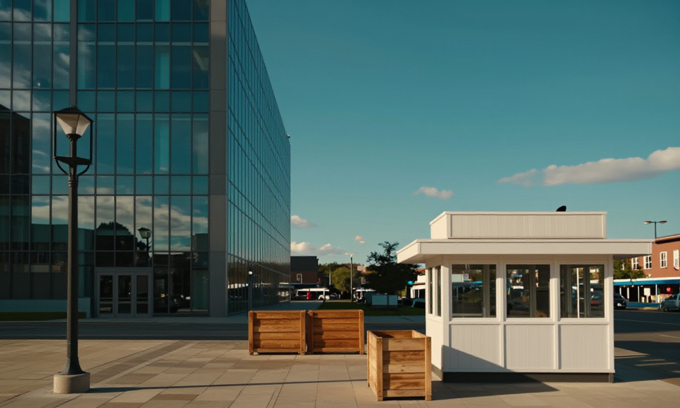
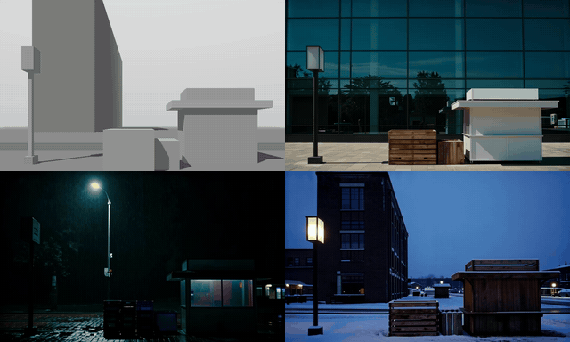

# Open Cinema Studio

[](https://github.com/ColinWWW/open-cinema-studio/actions/workflows/ci.yml)

Block out a shot with grey boxes and a camera path in your browser, give it one art-direction
frame, and get back a cinematic clip that follows your exact camera move and layout.
Open-weights only: **LTX-2.5 + the Layout-to-Render IC-LoRA** for the clip and **Z-Image-Turbo + a depth
ControlNet** for the art-direction frame, running in ComfyUI.

Entry for the [Comfy Open Source Higgsfield Challenge](https://comfy.org/open-source-higgsfield)
(Open Weights Only + VFX Workflow Built with LTX). Name TBD. Submission checklist and demo shot list:
[docs/submission/](docs/submission/CHECKLIST.md).

<p align="center">
  
</p>
<p align="center"><sub>Left: the shot blocked in the browser (grey boxes + a keyed dolly-in). Right: the LTX-2.5 render, which
follows that camera move and layout. Real A40 output, stage 1, from <code>examples/</code>.</sub></p>

> Status: both pipelines pass on an A40. The look still (Z-Image-Turbo + depth ControlNet) is generated from the
> layout's own depth, so it lines up box for box, and the stage-1 video render from it keeps both the look and the
> layout (see [Examples](#examples)). Stage 2 (1920×1088: an x2 latent upscale and 3 refine steps) is built from core nodes and current ComfyUI
> accepts the graph, but it hasn't been run on the GPU yet. Plan, specs and budget:
> [docs/PLAN.md](docs/PLAN.md).

## Try it

**Live:** https://colinwww.github.io/open-cinema-studio/ *(goes live on submission night)*. Use Chrome or Edge.

On a first visit the page replays a real render of the plaza example step by step (**▶ Demo** plays it
again): the layout, its depth, the look still and the LTX-2.5 render, with the real A40 timings sped up.
The page is the whole blocking tool: load the **Plaza** preset (or block your own shot), scrub the
camera, and **Export playblast**, all in your browser. **Render…** needs a render server with a GPU
behind it; when none answers, the panel shows a **Demo**: the bundled plaza example (layout clip, its
depth, the look still generated from it and the LTX-2.5 render, all real A40 outputs from `examples/`).

To render your own shots from the live page, start the render server (setup and Comfy targets in
[Render](#render-comfy-sdk)) so that the page may call it, then paste its URL (`http://127.0.0.1:8190`)
into **Render server URL**. Chrome may ask to let the page reach devices on your local network: allow it.

```bash
python -m server.app --cors-origin https://colinwww.github.io     # + --comfy-url for your own ComfyUI
```

## Examples

All from the same plaza layout on an A40, stage 1 (960×576, 65 frames). Click a contact sheet for full size.

| Blocked in the browser | Look still, generated from its depth | LTX-2.5 render |
|---|---|---|
|  |  | [`stage1_genlook_plaza_a40.mp4`](examples/stage1_genlook_plaza_a40.mp4) |

- Layout clip, frame by frame: [contact sheet](examples/layout_plaza_dolly_in_frames.png)
- Render from the generated look still: [contact sheet](examples/stage1_genlook_plaza_frames.png)
<!-- Same blocking, three looks: uncomment once `python scripts/three_looks.py` has run on the GPU.
<p align="center"></p>
<p align="center"><sub>One layout, three prompts: same blocking and camera, only the look changes (<code>scripts/three_looks.py</code>).</sub></p>
-->

- Render from a reference photo instead ([`look_plaza.jpg`](examples/look_plaza.jpg)): [contact sheet](examples/stage1_core_plaza_frames.png)

## How it works

1. **Block** — place primitives and keyframe a camera in a three.js editor.
2. **Playblast** — export the grey scene deterministically: 24 fps, 8k+1 frames, dimensions divisible by 64.
3. **Art-direct** — generate a finished-looking first frame from the layout's depth and your prompt (or bring your own).
4. **Render** — LTX-2.5 + Layout-to-Render follows the layout clip's camera and blocking, and takes its look from the first frame.

## Blocking tool

Needs Node 20+ and Chrome or Edge (the playblast is encoded in the browser with WebCodecs).

```bash
cd web && npm install && npm run dev
```

Open http://localhost:5173, add boxes, people and walls, then turn on **Look through shot camera**,
frame the shot and press **K** to key it on the timeline. Or frame frame 0 and pick a one-click move under
**Apply move**: dolly in/out, truck, crane, orbit or locked off. A scene can hold several **shots** (cameras
over the same blocking): **+ Shot** copies the current one, ↑/↓ set the order of the cut. **Export playblast** renders every frame at
exactly 1/24 s steps to an H.264 MP4 (960×576 or 1920×1088, 65/97/121 frames) plus PNGs of frame 0 and
its depth map (near = white, sky = black).
With the dev server running, exports are also written to `web/exports/`. Scenes save as JSON;
the **Blocks** and **Plaza** presets reproduce `scripts/make_test_layout.py`'s clips.

Tests: `cd web && npm test`. Smoke test of the production build as GitHub Pages serves it (no render
server): `npm run test:e2e` (Playwright; in Chrome the demo clips are also checked to decode).

## Render (Comfy SDK)

`server/` is a small local server that takes the playblast, a look still and a prompt, runs our
stage-1 workflow ([workflows/stage1_layout_api.json](workflows/stage1_layout_api.json), built from
ComfyUI core nodes by `server/workflow.py`; a 1920×1088 playblast also gets stage 2,
[workflows/two_stage_layout_api.json](workflows/two_stage_layout_api.json)) through the official
[Comfy SDK](https://docs.comfy.org/development/api-development/sdks), and returns the clip.
The SDK talks to Comfy Cloud by default, or to any ComfyUI behind
[comfy-api-proxy](https://github.com/Comfy-Org/comfy-api-proxy) via `COMFY_BASE_URL`.

```bash
pip install -r server/requirements.txt
COMFY_API_KEY=comfyui-... python -m server.app                          # Comfy Cloud (paid plan)
python -m server.app --comfy-url http://127.0.0.1:8189                  # your own ComfyUI + comfy-api-proxy
COMFY_API_KEY=<proxy token> python -m server.app --comfy-url https://<pod>-8189.proxy.runpod.net   # RunPod
```

Before spending GPU time, `python -m server.doctor` checks the Python side and the Comfy target, and with
`--comfyui http://127.0.0.1:8188` (ComfyUI itself, not the proxy) that every node and model file our workflows
use is there.

`--cors-origin <origin>` lets a page served from elsewhere (the live link) call the server; `--host 0.0.0.0`
listens beyond localhost (e.g. on a pod, then use its `https://<pod>-8190.proxy.runpod.net` URL).

Then in `web/` (`npm run dev`) press **Render…**, write a one- or two-sentence prompt describing the
finished shot, and press **Generate look still**: the panel exports the playblast (only if the scene
changed), sends frame 0's depth map to our look-still workflow
([workflows/look_still_depth_api.json](workflows/look_still_depth_api.json): Z-Image-Turbo + the Fun
ControlNet Union in depth mode, core nodes only), and shows the still next to frame 0 and its depth.
Because the still is generated from the layout's own depth, it lines up with the playblast box for box,
which is what makes the video render keep both the look and the layout (a still that doesn't match
wins over the layout). Not happy? Change the seed or the prompt and generate again, or press **3 variants** for three seeds at
once: every still stays in a strip under the panel, so you can click back to the one you liked.
**Prompt ideas…** fills in a starter prompt.

**Render all shots** renders a whole scene: for each shot, in order, it exports the playblast, generates its
look still (same prompt and seed for every shot, so they share a look) and renders it, then cuts the renders
together into one sequence, with the layout sequence beside it to compare (`POST /api/stitch`, no re-encode).
Budget about 2.5–4 minutes per 65-frame shot on an A40. While a job runs, the status line names the node
and sampler step, and **Cancel** stops it on the GPU too (`POST /api/render/<id>/cancel`). Then press
**Render shot**. **Choose look still…** still takes your own image instead (same framing as frame 0).

Without the server:

```bash
python -m server.look web/exports/<shot>_depth.png "prompt" -o look.png        # look still (~1 MP, then playblast size)
python -m server.render web/exports/<shot>.mp4 look.png "prompt" -o out.mp4    # the clip (1920×1088: + stage 2; --stage1-only to skip)
python -m server.stitch shot1.mp4 shot2.mp4 shot3.mp4 -o sequence.mp4          # cut renders together
```

No GPU? Run the whole chain against a stand-in ComfyUI that returns the layout as the "render" (and
the depth map as the "look still"):

```bash
python -m server.mock_comfyui --port 8188 &
comfy-api-proxy --comfyui http://127.0.0.1:8188 --port 8189 &
python -m server.app --comfy-url http://127.0.0.1:8189
```

Tests: `python -m unittest discover -s server/tests -t .` (the end-to-end ones start the mock and the proxy).

## Try the pipeline now

Make a test layout clip locally (needs Python with numpy, and ffmpeg or `pip install imageio-ffmpeg`):

```bash
python scripts/make_test_layout.py --move dolly_in -o examples/layout_dolly_in.mp4
```

Moves: `dolly_in`, `orbit`, `crane_up`, `truck`.

## GPU setup (RunPod)

On a RunPod "ComfyUI – CUDA 12.8" pod with a ≥ 80 GB volume at `/workspace`:

```bash
cd /workspace && git clone <this repo> cinema-studio && cd cinema-studio
nohup bash scripts/idle_shutdown.sh > /workspace/idle_shutdown.log 2>&1 &   # terminates the pod when idle
bash scripts/setup_pod.sh                                                   # ~42 GB LTX + ~28 GB look-still models
```

First accept the terms on both gated LTX repos (see below) and have a Read token ready. The look-still
models aren't gated; `bash scripts/setup_look_models.sh` fetches just those.

## Models and licenses

| Model | Use | License |
|---|---|---|
| [LTX-2.5 22B distilled (int8)](https://huggingface.co/Lightricks/LTX-2.5) + Gemma text encoder, VAEs, x2 upscaler | video generation | LTX-2.x community license (gated) |
| [LTX-2.5 IC-LoRA Layout-to-Render](https://huggingface.co/Lightricks/LTX-2.5-22b-IC-LoRA-Layout-To-Render) | layout → finished shot | LTX-2.x community license (gated) |
| [Z-Image-Turbo](https://huggingface.co/Comfy-Org/z_image_turbo) (bf16, Qwen3-4B text encoder, VAE) | look still (first frame) | Apache-2.0 |
| [Z-Image-Turbo Fun ControlNet Union 2.1](https://huggingface.co/alibaba-pai/Z-Image-Turbo-Fun-Controlnet-Union-2.1) (2602, 8-step) | depth control for the look still | Apache-2.0 |

Why not FLUX 3 Image Klein for the still: it has no depth/structure control (no ControlNet or control
LoRA; its reference images and boxes guide content and placement but don't lock the layout), and a
look still that drifts from the layout gets the layout ignored.

> **Commercial use:** the weights are free to download and run, but their licenses limit commercial
> use (the LTX-2.x community license caps it by company revenue). If you use this project's output
> commercially, check each model's license and get a commercial license from the model maker where
> it's required. The MIT license below covers only this repo's code, not the models.

No partner nodes or closed APIs are used. Check any workflow with
`python scripts/check_open_weights.py workflows/*.json`.

## License

Code: MIT ([LICENSE](LICENSE)). Model weights are under their own licenses above.
