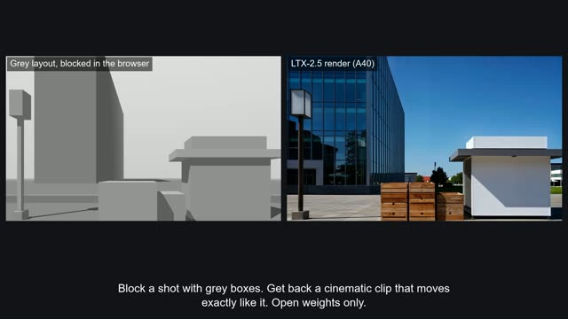
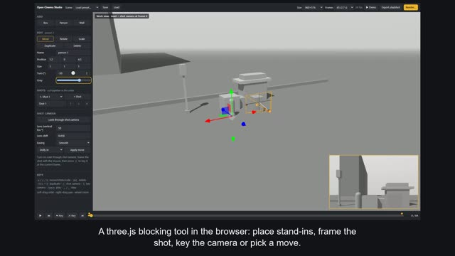
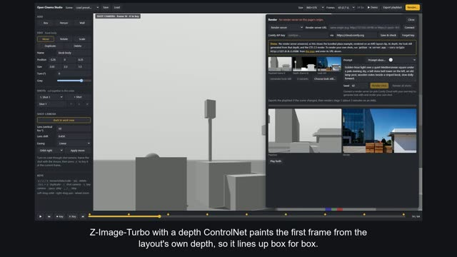
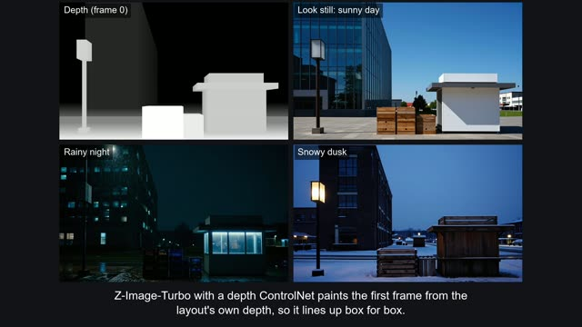
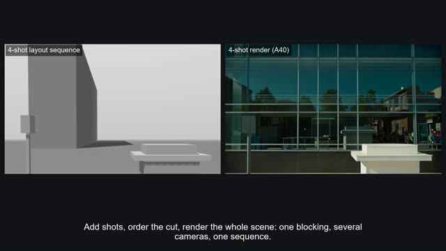
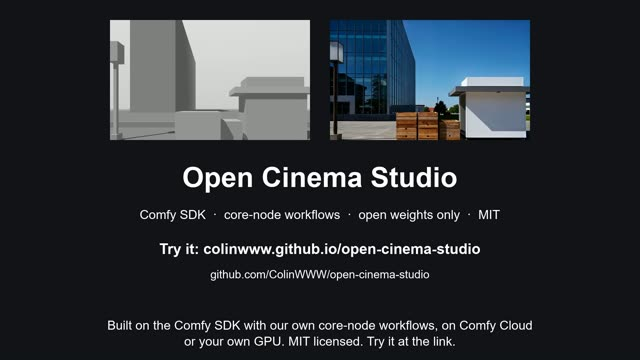

# Demo video

Builds the submission video, `demo/demo.mp4` (1920×1080, 24 fps, 1:59.5), from the command line with no
GPU and no render server. The shot list and captions follow
[DEMO_SCRIPT.md](../../docs/submission/DEMO_SCRIPT.md); the renders are the real A40 outputs in
`examples/`.

```bash
cd web && npm ci && cd ..                                # once: Playwright and Vite
PW_CHANNEL=chrome node scripts/demo/record.mjs           # ~2 min: demo/raw/editor.webm + beats.json
python scripts/demo/assemble.py                          # ~1 min: demo/demo.mp4
```

Needs Node 22, Python 3.10+ and `ffmpeg` on the PATH. `demo/` is in `.gitignore`: don't commit the video.

| | |
|---|---|
|  |  |
|  |  |
|  |  |

<sub>Frames from a run on Windows in Edge (`CHROMIUM_PATH=".../msedge.exe"`, which has the H.264 encoder, so the
real playblast beat is in) with the Oct 21 A40 renders; `frames/` holds these only for this page.</sub>

## What each script does

**`record.mjs`** builds `web/`, serves it with `vite preview`, and drives it in Playwright at
1920×1080 with video recording on, with a visible cursor and pauses so each step reads. It records
one video and writes each beat's start and end to `beats.json`:

| Beat | Steps |
|---|---|
| `block` | Load the Plaza preset, add a box and a person and place them, *Look through shot camera*, *Apply move: Orbit right*, Space to play |
| `playblast` | *Export playblast*: the progress bar, then the MP4, frame 0 and depth links |
| `render` | *Render…* with no server, so it opens in demo mode on the bundled plaza example; pick a prompt idea |

Confirmations are accepted both ways: native `confirm()` through `page.on('dialog')`, and the app's
in-app dialog (`[role="alertdialog"]`, `#dialog-ok`) when it's there.

Options: `--headed` to watch it, `--no-build` to reuse `web/dist`, `--out <dir>` (default `demo/raw`).
`DEMO_PORT` changes the preview port (default 4180), `CHROMIUM_PATH` picks a browser binary.

**`assemble.py`** cuts the beats together with the renders, captions each part with `drawtext`, and
puts layout and render side by side for the render beats:

| Time | Part | Source |
|---|---|---|
| 0:00 | Hook | layout ∣ render, plaza dolly-in |
| 0:08 | Block | `block` beat |
| 0:30 | Playblast | `playblast` beat, then layout clip ∣ frame 0 ∣ depth |
| 0:40 | Art-direct | `render` beat, then depth and three look stills (day, night, snow) |
| 1:00 | Render | layout ∣ render, then stage 2 at 1920×1088 |
| 1:15 | A scene, not a clip | 4-shot layout sequence ∣ 4-shot render |
| 1:30 | Same blocking, any look | `three_looks_plaza.mp4` (2×2) |
| 1:45 | How it's built | title card with the live link and repo |

Options: `--raw <dir>`, `-o <file>`. It fails if the result runs over 2:00. To change a caption or a
timing, edit `parts()` in `assemble.py` and the table in DEMO_SCRIPT.md together.

## Notes

- **Use Chrome or Edge**: `PW_CHANNEL=chrome` (the same as CI's smoke test), or point `CHROMIUM_PATH` at
  `msedge.exe` or `chrome.exe` on Windows. Recording works on Windows too: `record.mjs` runs `npm`/`npx`
  through a shell there and stops the preview server with `taskkill`. Playwright's bundled Chromium has
  no H.264 encoder, so *Export playblast* can't run there: `record.mjs` skips that beat and
  `assemble.py` fills the slot with the bundled plaza playblast. Chromium also can't play the Render
  panel's H.264 clips, so the demo panel's videos stay black in its recording.
- **Pace.** Each beat is fitted to its slot: a recording that ran slow is sped up, a quick one holds
  its last frame. On a machine without a GPU browser (software WebGL at a few frames a second) the
  `block` beat records at about 70 s and plays back about 3× faster; with a GPU it records close to
  its 22 s slot. `record.mjs` prints the page's frame rate when it starts.
- No voice-over: the captions carry the script. Add audio afterwards with
  `ffmpeg -i demo/demo.mp4 -i vo.wav -c:v copy -c:a aac -shortest demo/demo_vo.mp4`.
